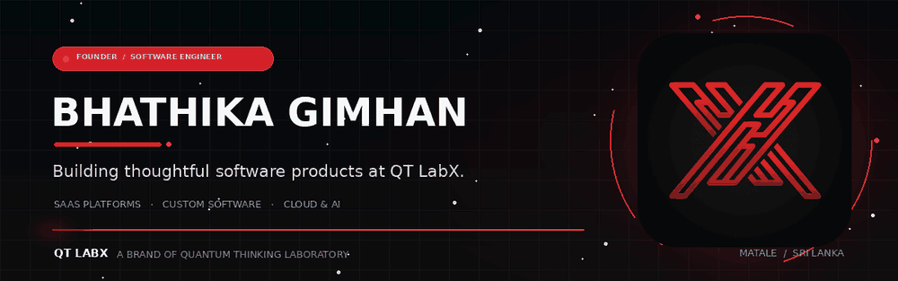

<!--
  QT LabX-inspired GitHub profile refresh
  Repository: https://github.com/BhathikaGimhan/BhathikaGimhan
  Keep the assets/ directory beside this README.md.
-->

  

  
  
  

<h1 align="center">Hi, I'm Bhathika Gimhan</h1>

  <strong>Founder · Software Engineer · Product Builder</strong> 
  Building thoughtful software products and digital systems through <strong>QT LabX</strong>.

  

## About

I'm **Bhathika Gimhan**, a Software Engineer and the Founder of **QT LabX**, a technology brand of Quantum Thinking Laboratory based in Matale, Sri Lanka.

I lead software development at QT LabX, where we turn ideas into practical software — from SaaS platforms and custom applications to cloud solutions and connected systems. Our approach starts with understanding the business, its workflows and the people who use the software.

**My focus:** engineering useful products, solving real operational problems, and bringing ideas to life through technology.

## What we're building at QT LabX

| Product | What it does |
|:--|:--|
| **[SSE — Smart School Ecosystem](https://qtlabx.com/solutions/school-management)** | A connected school workspace for admissions, academics, staff operations, fees and communication, with web, teacher and parent experiences. |
| **[Auto](https://qtlabx.com/solutions/auto)** | Workshop management and a digital garage that connect service jobs, parts, vehicle records and service updates. |
| **[Jiyara](https://jiyara-studio.web.app/)** | An AI-assisted creative studio for generating and refining marketing visuals and product content. |
| **[TiKi](https://chromewebstore.google.com/detail/tiki/jgapjnphcimmmnpipcpajojnpcfcpmdp?hl=en)** | An AI learning companion for the web. Select text on a page and get clear explanations in your preferred language. |
| **[FinalPitch](https://finalpitch.qtlabx.com/)** | A preview marketplace for discovering and listing academic projects. |

  

## Areas of work

- **Product engineering** — turning ideas and workflows into usable software products.
- **Custom software** — applications shaped around business requirements.
- **Cloud & AI solutions** — cloud-native systems and AI-enabled experiences.
- **Connected systems** — bringing software, infrastructure and security technology together.

QT LabX is an **official Google Cloud Partner** and works with **Hikvision** through a connected-security technology partnership.

## Technologies & tools

These are technologies and tools represented in my development profile, grouped by area.

  <strong>Frontend</strong> 
  

  <strong>Backend & application development</strong> 
  

  <strong>Mobile development</strong> 
  

  <strong>Cloud, databases & developer tools</strong> 
  

  <strong>Design & creative tools</strong> 
  

## GitHub activity

  
  

  

  

## Let's connect

Have an idea, a product challenge or a project worth building?

- **QT LabX:** [qtlabx.com](https://qtlabx.com)
- **Email:** [contact@qtlabx.com](mailto:contact@qtlabx.com)
- **LinkedIn:** [linkedin.com/in/bhathika](https://linkedin.com/in/bhathika)
- **GitHub:** [@BhathikaGimhan](https://github.com/BhathikaGimhan)

  

  Ideas, engineered into software. · Matale, Sri Lanka

